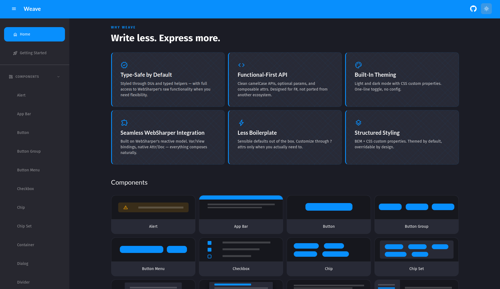
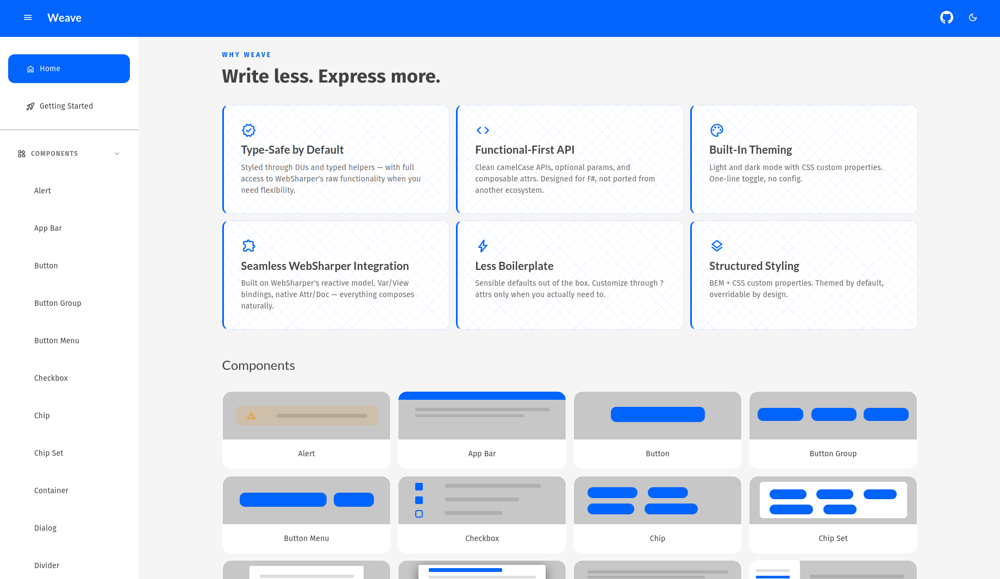

# Weave

<div align="center">
    
</div>
<div align="center">
    <i>Threading Logic. Fabricating UI.</i>
</div>
<br/>

[Weave](https://1eyewonder.github.io/Weave) is a component library for building web applications in F# with [WebSharper](https://websharper.com/). It provides a growing set of reusable UI components, layout primitives, and styling utilities designed to reduce boilerplate and improve developer experience.

Weave is opinionated where it matters — consistent theming, ergonomic APIs, and structured styling — while remaining flexible enough to work seamlessly with native WebSharper constructs.

> **Note:** Weave is currently in active development and serves as an experimental playground. No packages exist as of yet. Breaking changes are expected as design patterns mature.

## Why Weave?

WebSharper provides a powerful foundation for full-stack F# web development, but it lacks a cohesive, modern component ecosystem comparable to what exists in other frameworks. While working in WebSharper, I found myself reaching for the kind of ergonomics and completeness that component libraries in other ecosystems take for granted — clean APIs, minimal boilerplate, rich theming, and strong developer experience. Weave is an attempt to bring those qualities to F# and WebSharper.

Weave aims to fill that gap by providing:

- **Type-safe styling** — Discriminated unions and typed helpers guide you to valid styles, without locking you out of WebSharper's raw functionality when you need it
- **A functional-first API** — Clean camelCase members, optional parameters, and composable attrs, designed for F# from the ground up
- **Built-in theming** — Light and dark mode via CSS custom properties with a one-line toggle
- **Seamless WebSharper integration** — Reactive `Var`/`View` bindings, native `Attr`/`Doc` types, and full interop with existing WebSharper code
- **Less boilerplate** — Sensible defaults out of the box; customize only when you need to
- **Structured styling** — BEM naming conventions and CSS custom properties, themed by default and overridable by design

This is not a port of patterns from another ecosystem — it is a reinterpretation with an F# mindset.

## Component Design Philosophy

### Functional Language, Practical API

F# encourages partial application and functional composition. However, UI components often require many optional parameters — events, styles, variants, and configuration options.

To avoid excessive function overloads and deeply nested parameter patterns, Weave components use classes with optional parameters:

```fsharp
Button.create(
    text "Hello World!",
    onClick = (fun () -> ())
)
```

This provides:

- Clear discoverability via IntelliSense
- Predictable component construction
- A manageable API surface
- Extensibility as components grow in complexity

Future iterations may explore Computation Expressions (CEs) to provide a more idiomatic F# feel without sacrificing usability.

### Strongly-Typed Styling

Styling in Weave is designed to be discoverable, constrained, composable, and type-safe where practical. Rather than relying on raw strings for CSS classes, Weave provides modules and helpers that map directly to supported styling variants:

```fsharp
Button.primary(
    text "Hello World!",
    onClick = (fun () -> printfn "Clicked!"),
    attrs = [
        Button.Variant.outlined
    ]
)
```

This approach improves IntelliSense discoverability, reduces invalid style combinations, and keeps styling aligned with component intent. Developers still retain full access to WebSharper's native styling tools (`Attr.Style`, raw classes, etc.) when flexibility is required.

## Theming

Weave includes built-in theming with support for light and dark modes, runtime theme switching, and centralized theme configuration through `Theming.fs`.

### Dark Theme



### Light Theme



## Getting Started

### Development Setup

1. Open `weave.code-workspace`
2. Install the recommended extensions
3. Run the initialization script:

    ```bash
    ./build.sh init     # Linux/macOS
    ./build.cmd init    # Windows
    ```

4. Start the docs development server from the repository root:

    ```bash
    yarn dev:docs
    ```

    Open the URL printed by Vite (normally `http://localhost:5173`). The command builds the site, then starts the Sass and .NET watchers and Vite together. Sass changes update the styles; F# changes rebuild WebSharper output and reload the page, which may reset page state. Press Ctrl+C to stop them all. This workflow serves the client-side docs; use the ASP.NET host below if server-side functionality is needed.

    Alternatively, build the styles and start the documentation site with ASP.NET:

    ```bash
    yarn build:css
    dotnet run --project src/Weave.Docs/Weave.Docs.fsproj
    ```

    Navigate to the URL printed by ASP.NET to view the documentation and interactive examples.

## Testing

### Without Docker

**Dependencies:** .NET 10 SDK, Node.js 22.12+

```bash
./build.sh RunTests    # Linux/macOS
./build.cmd RunTests   # Windows
```

### With Docker

**Dependencies:** Docker

```bash
docker compose build
docker compose run --rm playwright-tests
```

The Docker path runs Playwright rendering tests in a pre-configured browser environment. Use this if you don't have .NET 10 or Node.js 22 installed locally, or to match CI behavior exactly.

To run the full browser interaction suite across Chromium, Firefox and WebKit locally, first install the matching Playwright browsers, then run the dedicated build target:

```powershell
pwsh tests/Weave.Tests.E2E/bin/Debug/net10.0/playwright.ps1 install chromium firefox webkit
./build.cmd RunBrowserTests
```

The normal `RunTests` target still uses Chromium by default. The all-browser target runs mobile-emulation tests in Chromium and WebKit; Firefox runs the other interactions because Playwright does not document Firefox mobile emulation as supported. The CI browser matrix runs these same suites in parallel.


## Contributing

Community interest will shape the future of Weave.

- Open issues to report bugs or suggest features
- Submit pull requests
- Share design ideas
- Discuss on the F# Discord

Even early feedback is valuable at this stage.
