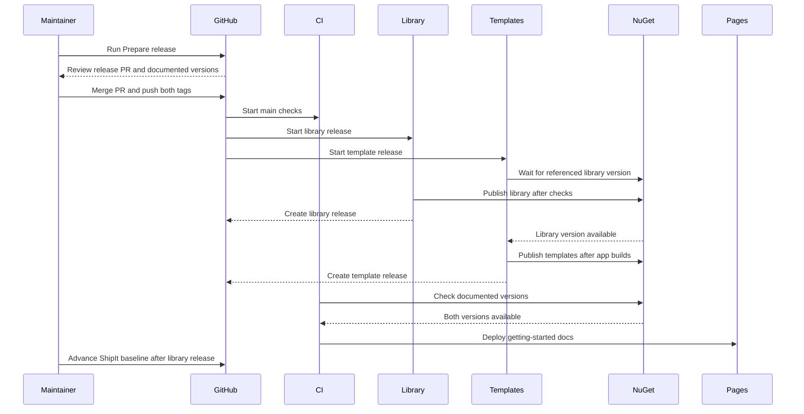
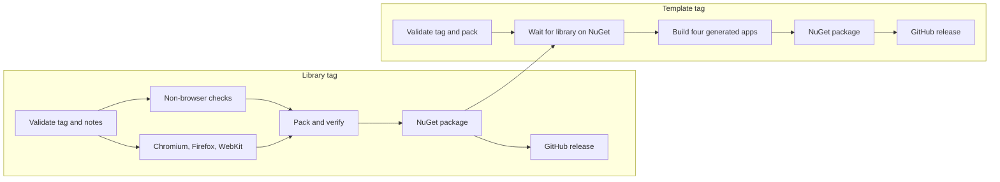

# Release playbook

The tag commands in this playbook are examples. Replace their versions when running them, but do not edit the example commands in this file for each release. Agents and maintainers should update release metadata and `src/Weave.Docs/PackageVersions.fs` instead; the getting-started commands use those constants.

## ShipIt baseline

`CHANGELOG.md` records the latest published library tag's commit as `last_commit_released`. After each library release, update that value before preparing the next release. In GitHub **Settings → Actions → General**, allow Actions to create pull requests.

## Subsequent releases

1. On GitHub, open **Actions → Prepare release → Run workflow**, select `main`, and click **Run workflow**. `prepare-release.yml` runs ShipIt, which opens or updates a release PR.
2. Review the changelog and WebSharper compatibility notes. Update only the package versions being released in `src/Weave.Docs/PackageVersions.fs` in this release PR; the getting-started commands use those constants. Review `README.md` and `templates/README.md` for release-status language; their stable-package links and install command do not require version edits. If shipping templates too, update `templates/WeaveVersion.props` to the library version, run `dotnet fsi templates/SyncWeaveVersion.fsx`, and set the template package version in `templates/Weave.Templates/Weave.Templates.fsproj`. Add those changes to the release PR before merging so both tags can point to its merge commit.
3. Merge the PR into `main`. Tag its merge commit with the library version. If the templates are ready, tag the same commit with their package version and push both tags in one command:

   ```sh
   git checkout main
   git pull --ff-only
   git tag -a v0.3.0 -m "v0.3.0"
   git tag -a templates-v0.3.0 -m "templates-v0.3.0"
   git push --atomic origin v0.3.0 templates-v0.3.0
   ```

   Use the actual versions from the merged files; the library and template versions can differ. The atomic push ensures GitHub accepts both tag refs or neither, while their package workflows still publish independently. If only the library is ready, push only its tag.

4. **Release** tests, packs, verifies, and publishes the library. **Release templates** packs the templates, waits up to 45 minutes for their referenced library version to appear on NuGet, builds all four generated projects, and publishes the template package. Check the two workflow conclusions and their GitHub releases after they finish; there is no need to wait between pushing the tags.

The release workflows compare each tag with its version in `src/Weave.Docs/PackageVersions.fs`. A mismatch stops publication so the released package and getting-started instructions cannot silently diverge. Older tags created before this version file existed remain eligible for manual retries.

For a stable release, remove `pre_release: rc` from the changelog front matter before running ShipIt. Tags must point to a commit reachable from `main`.

## Release templates

For a template-only release, set the referenced library version in `templates/WeaveVersion.props`, run `dotnet fsi templates/SyncWeaveVersion.fsx`, set the template package version in `templates/Weave.Templates/Weave.Templates.fsproj`, and update the template version in `src/Weave.Docs/PackageVersions.fs` in the same PR. Merge the PR to `main`, tag that commit, and push the template tag:

   ```sh
   git checkout main
   git pull --ff-only
   git tag -a templates-v0.3.1 -m "templates-v0.3.1"
   git push origin templates-v0.3.1
   ```

**Release templates** restores and builds each generated app, checks the stylesheets, and publishes the package and GitHub release. Confirm the NuGet trusted-publishing policy for `release-templates.yml`, environment `nuget`, and package `Weave.WebSharper.Templates` is configured.

The library and template workflows run independently. The template workflow waits for the referenced library package on NuGet, so both tags may be pushed together when their source versions are ready.

## After publication: advance the ShipIt baseline

The CI Pages deployment waits for the versions in `src/Weave.Docs/PackageVersions.fs` to appear on NuGet and skips deployment if a newer commit has reached `main`. Versioned documentation can therefore be merged with the release PR without publishing an install command on the documentation site before the packages are available. The repository README and template guide use version-independent stable-package instructions, so they remain accurate during the publication window.

After a library release succeeds, update `last_commit_released` in `CHANGELOG.md` to the commit referenced by its published tag, then merge that change through the normal review process. The merge commit is unknown when the release PR is prepared, and the baseline must not advance if publication fails. A template-only release does not change this baseline.

Check the published package versions, GitHub releases, and deployed getting-started page after the workflows finish. If the package publication fails, fix or rerun the release using its existing tag before updating the baseline.

## Workflows

- **Prepare release** (`prepare-release.yml`): run manually to have ShipIt propose a changelog and version in a pull request. It does not publish or create a release tag.
- **Release** (`release.yml`): runs when you push a `v` tag; it tests, packages, publishes to NuGet, and creates the GitHub release. It can also be run manually to retry an existing tag.
- **Release templates** (`release-templates.yml`): runs when you push a `templates-v` tag; it waits for the referenced library package, validates the generated projects, and publishes the template package. It can also retry an existing tag manually.

Publishing uses NuGet trusted publishing via `NuGet/login@v1` and the `nuget` GitHub Actions environment. Configure a separate NuGet policy for each workflow (`release.yml` for `Weave.WebSharper` and `release-templates.yml` for `Weave.WebSharper.Templates`); the workflows do not use a stored `NUGET_TOKEN` secret.

## Release flow

The release PR carries the changelog, any template version changes, and the documented package versions. Its merge starts CI. Pushing both tags starts the package workflows independently; the template and Pages workflows wait for the package versions they need.



The library workflow validates the tag, then runs non-browser checks and the three browser suites in parallel. Publication waits for all checks. The template workflow packs the template package, waits up to 45 minutes for its referenced library version on NuGet, builds all four generated apps, and then publishes.



For a library-only or template-only release, push only that package's tag. The Pages deployment checks both versions in `src/Weave.Docs/PackageVersions.fs`; a version from an earlier successful release passes immediately.

## Commit prefixes

| Prefix                                                                        | Use for                   | Stable version effect   |
| ----------------------------------------------------------------------------- | ------------------------- | ----------------------- |
| `feat:`                                                                       | A new feature             | Minor                   |
| `fix:`                                                                        | A bug fix                 | Patch                   |
| `perf:`                                                                       | A performance improvement | Minor                   |
| `feat!:` or `fix!:`                                                           | A breaking change         | Major                   |
| `docs:`, `test:`, `refactor:`, `style:`, `build:`, `ci:`, `chore:`, `revert:` | Other changes             | No release on their own |

Examples: `feat(tabs): add keyboard navigation` and `fix: correct dialog focus`. ShipIt uses `feat`, `fix`, `perf`, and breaking changes for release notes. During a prerelease cycle, ShipIt increments its RC number instead of applying the stable-version bumps above.

## Working between releases

- Use these prefixes for commits and squash merges.
- In each clone, run `dotnet tool restore` and `git config core.hooksPath hooks` to enable the commit-message hook. `build.sh` and `build.cmd` also configure the hook path.
- Preview ShipIt with `dotnet shipit --dry-run --skip-merge-commit`. Fix invalid commit messages rather than silently skipping them.

## If a release fails

Keep the package that published successfully. Recover the failed package according to where it stopped:

| State                                                       | Recovery                                                                                                                                                                                                                                                                                        |
| ----------------------------------------------------------- | ----------------------------------------------------------------------------------------------------------------------------------------------------------------------------------------------------------------------------------------------------------------------------------------------- |
| Library fails before NuGet publishes; templates are waiting | For a transient failure, rerun **Actions → Release** with the existing library tag. If the template wait expires, rerun **Release templates** with its existing tag after the library appears on NuGet.                                                                                         |
| Library succeeds; templates fail before NuGet publishes     | For a transient failure, rerun **Release templates** with its existing tag. The library release and its tag remain valid; advance the library ShipIt baseline after its GitHub release succeeds.                                                                                                |
| A package needs a source fix before it can publish          | Merge the fix, choose a new package version, and create a new tag at the fixed commit. Do not move the failed tag or reuse its version. If a template references a changed library version, update and sync its starter projects too. Update `src/Weave.Docs/PackageVersions.fs` in the fix PR. |
| NuGet publishes, but GitHub release creation fails          | Confirm the exact version and package on NuGet, then create the matching GitHub release manually with the verified package and release notes. An already published NuGet version cannot be replaced.                                                                                            |

If templates reference an older library version that is already on NuGet, they can succeed even when a new library release fails. Keep the successful template release. The Pages deployment will wait for any unpublished version in `src/Weave.Docs/PackageVersions.fs` and eventually fail without replacing the deployed site. Complete the failed release, or change that version to the last published one in a new PR. A new `main` push starts CI; the normal post-release ShipIt baseline PR provides one after a successful library release. If the wait expires and no new push follows publication, as can happen with a template-only release, run **Actions → CI → Run workflow** on `main` to deploy the current docs. Advance `last_commit_released` only for a successfully published library release. If Pages is waiting on a failed package, defer merging a baseline-only PR until the documented version is published or corrected.

## Package checks

The tested baseline is WebSharper and WebSharper.FSharp `10.1.9.686` and WebSharper.UI `10.1.7.686`. Add a reproducible lock and CI coverage before claiming another combination.

A normal Release pack generates and embeds CSS and includes a content-file copy. The release checks that they match. Do not use `dotnet pack --no-build` for releases; applications must link the extracted stylesheet.
